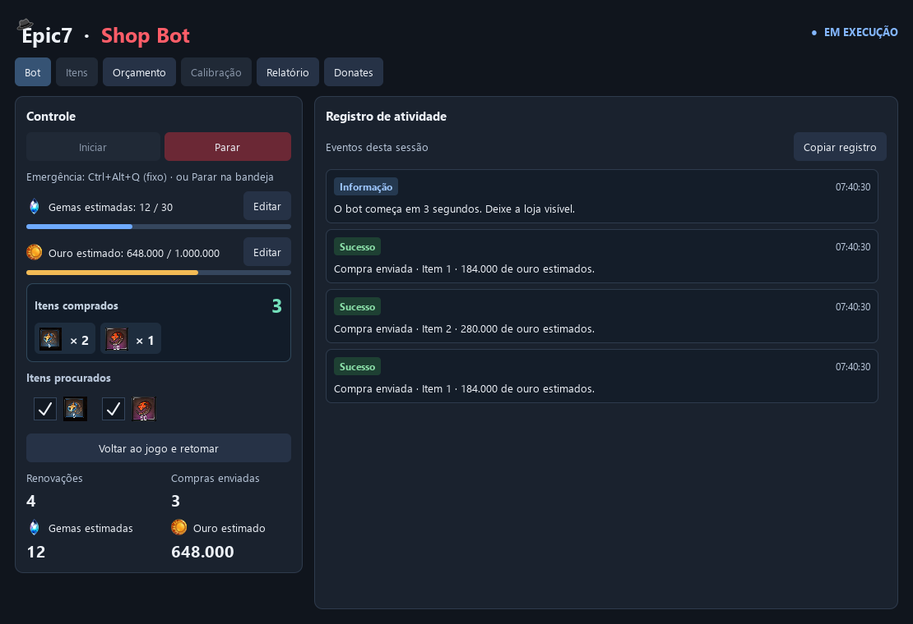
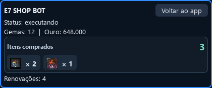
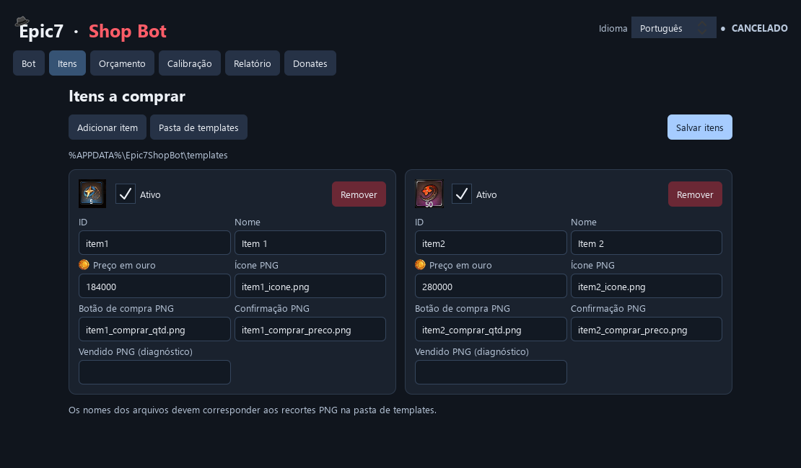
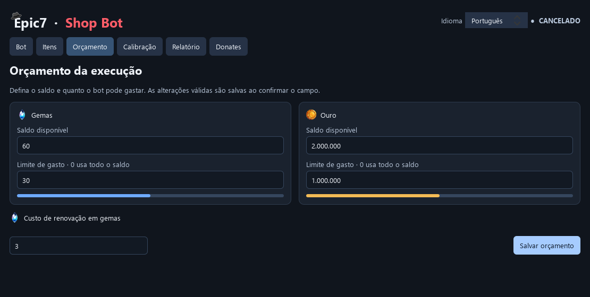
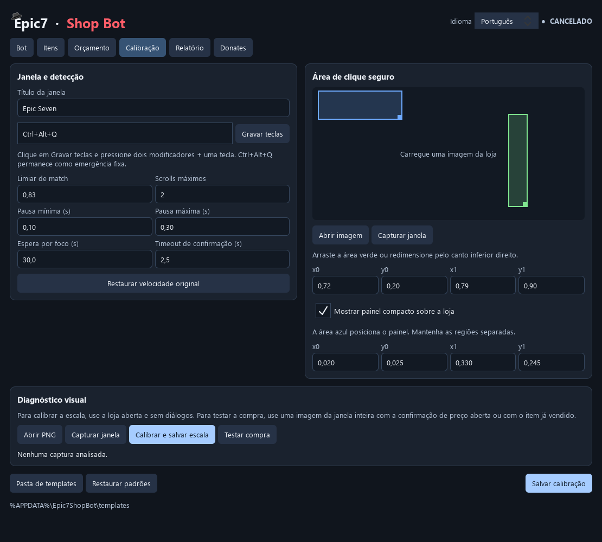
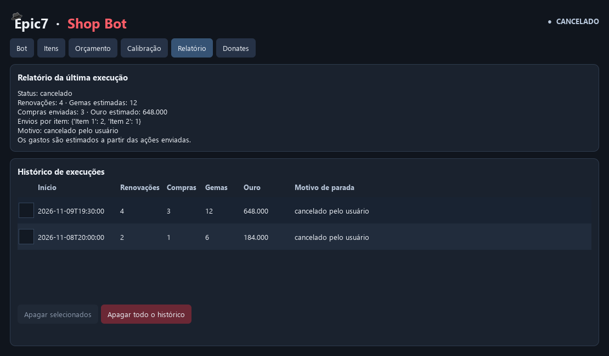
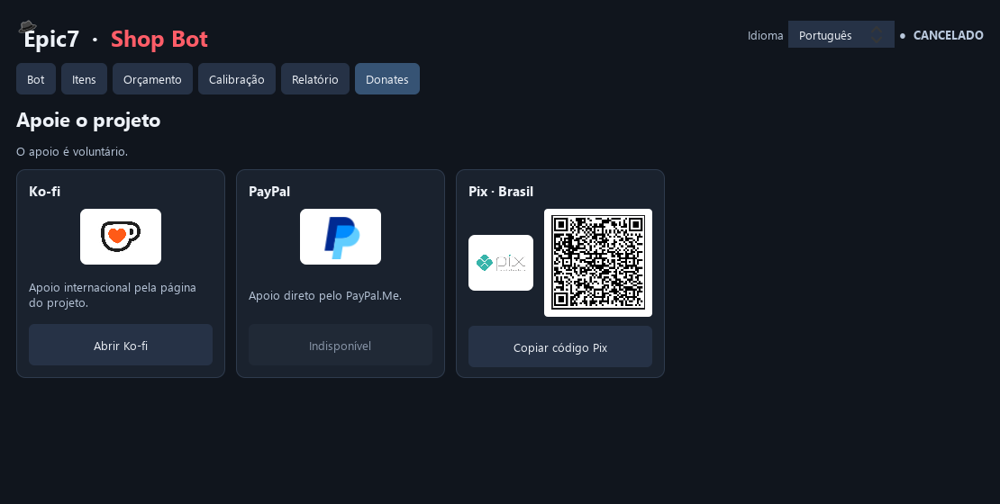

# Epic7 Shop Bot

Aplicativo para Windows que procura e compra os itens escolhidos na **Loja Secreta do Epic Seven**, renovando a loja dentro do orçamento definido por você.

[Baixar aplicativo](https://github.com/Frperoger/Rerol-Secretshop-e7/releases/latest) · [Código da v3](https://github.com/Frperoger/Rerol-Secretshop-e7/tree/v3) · [Reportar problema](https://github.com/Frperoger/Rerol-Secretshop-e7/issues) · [English guide](docs/README.en.md)



**Recursos:** reconhecimento por imagens, orçamento de gemas e ouro, calibração de escala por resolução, seleção de itens durante a execução, contadores com ícones, painel compacto sobre o jogo e histórico de sessões.

> As capturas deste guia mostram a interface QML da branch `v3`, com dados de demonstração. Elas podem incluir funções que ainda não chegaram ao último executável publicado. A interface principal está em português.

## Neste guia

- [Baixar e começar](#baixar-e-comecar)
- [Aba Bot e painel compacto](#bot)
- [Aba Itens](#itens)
- [Aba Orçamento](#orcamento)
- [Aba Calibração](#calibracao)
- [Aba Relatório](#relatorio)
- [Aba Donates](#donates)
- [Limitações e solução de problemas](#limitacoes)
- [Baixar e executar o código-fonte](#codigo-fonte)
- [Personalizar e gerar seu executável](#personalizar)
- [Arquivos locais e backup](#dados-locais)
- [Licença e restrições](#licenca)

<a id="baixar-e-comecar"></a>
## Baixar e começar

### O que é necessário

- **Windows de 64 bits.** O motor atual usa APIs do Windows; macOS e Linux não são suportados pela automação.
- Epic Seven aberto na **Loja Secreta**, com a janela visível e desobstruída.
- Imagens de reconhecimento compatíveis com o idioma e a aparência da sua loja. As imagens do repositório servem como ponto de partida.
- Para executar pelo código, **Python 3.11 de 64 bits**, a versão usada pelo processo de compilação do projeto.

### Instalação pelo pacote pronto

1. Abra a página de [Releases](https://github.com/Frperoger/Rerol-Secretshop-e7/releases/latest).
2. Em **Assets**, baixe o arquivo `Epic7ShopBot-<versão>-win64.zip`.
3. Extraia a pasta inteira para um local no seu computador.
4. Abra `Epic7ShopBot.exe` dentro da pasta extraída. Mantenha os arquivos e as subpastas do pacote juntos.

O pacote pronto dispensa Python. Os arquivos **Source code (zip/tar.gz)** são destinados a quem quer executar ou modificar o código; eles não são o aplicativo compilado.

### Primeira execução

1. Abra a Loja Secreta e deixe o jogo no tamanho e no zoom que serão usados durante a sessão.
2. Em **Itens**, confira os itens ativos, os preços e os arquivos PNG. Salve as alterações.
3. Em **Orçamento**, informe seus saldos e os limites de gasto.
4. Em **Calibração**, confira o título da janela, capture a loja e ajuste a área verde de clique seguro. Se usar o painel compacto, ajuste também a área azul.
5. Com a loja aberta **sem diálogos**, clique em **Calibrar e salvar escala**. Confira o diagnóstico e salve a calibração.
6. Na aba **Bot**, clique em **Iniciar**. O bot aguarda três segundos antes de começar; deixe a loja visível e com foco.
7. Para encerrar, use **Parar**, **Ctrl+Alt+Q** ou **Parar bot agora** no ícone da bandeja do Windows.

Comece com um orçamento pequeno para conferir o reconhecimento na sua máquina. Mantenha a posição, as dimensões e o zoom da janela durante a execução.

<a id="bot"></a>
## Aba Bot

A imagem no início deste guia mostra o painel principal. É aqui que você inicia, acompanha e encerra a sessão.

| Controle ou indicador | Para que serve |
| --- | --- |
| **Iniciar / Parar** | Começa a busca ou solicita a parada da execução. A parada é cooperativa: uma ação em andamento pode terminar antes do encerramento. |
| **Gemas estimadas / Ouro estimado** | Mostra o gasto acumulado em relação ao orçamento. **Editar** abre a aba Orçamento. |
| **Itens comprados** | Destaca o total e a quantidade de compras por item, com seus ícones. Os contadores começam do zero em cada execução. |
| **Itens procurados** | Permite ativar e desativar alvos durante a sessão. Desativar um alvo mantém suas compras anteriores no contador. |
| **Renovações** | Conta quantas renovações foram concluídas pelo fluxo do bot. |
| **Voltar ao jogo e retomar** | Libera a execução depois de uma pausa para consultar ou editar o aplicativo. Devolva o foco ao jogo. |
| **Registro de atividade** | Mostra compras enviadas, pausas, retomadas e avisos relevantes. **Copiar registro** copia esse conteúdo para compartilhar em um relato de problema. |

O contador registra **compras de cada item**, não a quantidade de unidades dentro de um lote. Por exemplo, comprar um lote de cinco unidades soma **uma compra** ao contador.

Para iniciar, é necessário ter ao menos um item ativo. Se você desativar todos os alvos durante a execução, o bot aguarda sem comprar nem renovar até algum deles ser reativado.

### Painel compacto sobre o jogo



Ative **Mostrar painel compacto sobre a loja** na aba Calibração. O painel exibe status, gastos, compras por item e renovações dentro da região azul configurada.

**Voltar ao app** solicita uma pausa em um ponto seguro e abre a janela principal. Depois, use **Voltar ao jogo e retomar**. O painel permanece sem tomar o foco do jogo e depende do suporte do Windows à exclusão da captura; se esse recurso falhar, ele é desativado e o aplicativo informa o ocorrido.

**Fechar a janela pelo X durante uma execução pode manter o bot ativo na bandeja.** Use os controles de parada para encerrar a automação.

<a id="itens"></a>
## Aba Itens



Use **Adicionar item** para criar um alvo, **Remover** para excluir seu cadastro e **Salvar itens** para validar e gravar a configuração. O cadastro fica bloqueado durante a execução; os alvos existentes continuam podendo ser alternados pela aba Bot.

| Campo | Como preencher |
| --- | --- |
| **Ativo** | Inclui o item na busca inicial. |
| **ID** | Identificador único: comece com uma letra minúscula e use letras minúsculas, números, `_` ou `-`, com até 32 caracteres. Exemplo: `item3`. |
| **Nome** | Nome exibido no aplicativo e nos relatórios. Prefira nomes diferentes para facilitar a leitura dos contadores. |
| **Preço em ouro** | Custo de uma compra do item. Esse valor alimenta o orçamento estimado; mantenha-o igual ao preço do jogo. |
| **Ícone PNG** | Recorte usado para reconhecer o item na loja. |
| **Botão de compra PNG** | Recorte do botão de compra na linha do item. O padrão atual usa a imagem de linha única `1/1 Comprar`. |
| **Confirmação PNG** | Recorte do botão de preço exibido antes do clique final da compra. |
| **Vendido PNG (diagnóstico)** | Opcional. Serve para analisar uma captura de item vendido; não é uma confirmação obrigatória após a compra. |

Os arquivos devem existir na **pasta de templates ativa** e os campos recebem somente seus nomes, como `item1_icone.png`, sem o caminho completo. O botão **Pasta de templates** permite escolher outra pasta; salve a configuração após a troca.

### Adicionar ou trocar as imagens de um item

1. Com o bot parado, capture a janela do jogo na resolução que você usa.
2. Faça recortes justos do ícone, do botão de compra e do botão de preço. Salve-os em PNG na pasta de templates ativa.
3. Preencha o novo cadastro e confira os nomes dos arquivos. Para reutilizar o botão `1/1 Comprar`, você pode apontar vários itens para o mesmo PNG compatível.
4. Clique em **Salvar itens**. O aplicativo informa imagens ausentes ou inválidas.
5. Faça uma nova calibração de escala e confira o diagnóstico antes de iniciar.

Os recortes `renovar.png` e `confirmar.png` também precisam existir: são usados na renovação da loja. O programa procura primeiro o ícone do item e depois o botão **à direita, na mesma linha**. Essa regra é interna e não possui um ajuste manual de “faixa da mesma linha”.

A compra de linha única já está integrada ao aplicativo e aos templates distribuídos. Para configurar outros itens, use o cadastro acima e os PNGs da pasta ativa.

<a id="orcamento"></a>
## Aba Orçamento



| Campo | Significado |
| --- | --- |
| **Saldo disponível** | Quantidade de gemas ou ouro que você informa ao bot. O aplicativo não lê automaticamente o saldo do jogo. |
| **Limite de gasto** | Máximo que a execução pode consumir. **0 usa todo o saldo informado**; zero não significa proibir gastos. |
| **Custo de renovação em gemas** | Custo de cada renovação. O padrão é 3; esse campo só pode ser alterado com o bot parado. |

O limite deve caber no saldo informado. Os campos aplicam alterações válidas ao confirmar a edição; **Salvar orçamento** também grava os valores. É possível ajustar os limites durante a sessão, respeitando os gastos já registrados e as ações em andamento.

**Exemplo:** com 60 gemas disponíveis e limite de 30, o bot pode registrar até dez renovações de três gemas. As compras continuam dependendo do orçamento de ouro e dos alvos ativos; a sessão pode terminar antes dessas dez renovações.

Os gastos e contadores são calculados a partir das ações enviadas. Confira os saldos reais no jogo, especialmente antes de reiniciar após uma interrupção.

<a id="calibracao"></a>
## Aba Calibração



O espaço da prévia é preenchido quando você abre uma imagem ou captura a janela do jogo. A captura acima mostra os controles antes de carregar uma imagem.

### Janela e detecção

| Opção | Quando usar |
| --- | --- |
| **Título da janela** | Identifica a janela do jogo. Use um título suficientemente específico para não encontrar várias janelas. |
| **Gravar teclas** | Registra o atalho adicional de emergência. **Ctrl+Alt+Q permanece disponível** como atalho fixo. |
| **Limiar de match** | Exigência de semelhança entre o PNG e a captura. O padrão é 0,83. Aumentar pode perder correspondências; diminuir pode aceitar imagens erradas. |
| **Scrolls máximos** | Limita as rolagens usadas para procurar os itens na loja atual. |
| **Pausa mínima / máxima** | Intervalo entre etapas. Valores menores podem ultrapassar o tempo das animações do jogo. |
| **Espera por foco** | Tempo máximo de espera para o jogo recuperar o foco. |
| **Timeout de confirmação** | Tempo de espera pelos elementos visuais de confirmação usados no fluxo. |
| **Restaurar velocidade original** | Recarrega os padrões de pausas e rolagens. Salve para aplicá-los. |

### Área verde e área azul

- **Verde — clique seguro:** escolha uma parte neutra da loja, sem botões de compra ou ações indesejadas. O bot usa essa região para os cliques de preparação da varredura.
- **Azul — painel compacto:** define a posição e o tamanho do acompanhamento sobre o jogo. Mantenha-a afastada dos botões que o bot precisa usar.

Arraste os retângulos para mover e use o canto inferior direito para redimensionar. Os campos `x0`, `y0`, `x1` e `y1` são proporções entre 0 e 1 da janela. As regiões verde e azul devem permanecer separadas quando o painel estiver habilitado.

### Calibrar e salvar escala

1. Deixe a loja aberta **sem diálogos**, com o botão Renovar visível.
2. Use **Capturar janela** ou **Abrir PNG** para carregar uma imagem da **janela inteira do jogo**, sem redimensioná-la em um editor.
3. Clique em **Calibrar e salvar escala**.
4. Confira se o diagnóstico reconheceu Renovar e, quando presentes na captura, os ícones e botões dos itens.
5. Clique em **Salvar calibração** para gravar as demais opções da aba.

A análise procura uma escala compatível, redimensiona os templates e salva o perfil para as dimensões da captura e o conjunto de PNGs. A calibração analisa a imagem **sem enviar cliques de compra ou mover o mouse**. A escala é salva pelo próprio diagnóstico quando validada; **Salvar calibração** grava os outros ajustes.

Faça uma nova calibração se mudar resolução, zoom, idioma ou templates. Um perfil salvo não garante reconhecimento de toda tela possível. A ausência de um item na captura também não prova que seu PNG está incorreto.

### Testar compra

**Esse botão faz um teste de reconhecimento em imagem; ele não realiza uma compra.** Carregue uma captura da janela inteira com a confirmação de preço aberta, ou com o item já vendido. O resultado informa a confiança das imagens configuradas para esses estados.

**Restaurar padrões** repõe os valores de fábrica da aba após confirmação. Use **Salvar calibração** para persistir a mudança. As opções de calibração ficam bloqueadas enquanto o bot está ativo.

<a id="relatorio"></a>
## Aba Relatório



- **Relatório da última execução:** mostra status, renovações, compras enviadas, gastos estimados, compras por item e motivo de parada.
- **Histórico de execuções:** mantém os resultados gravados no computador e exibe os 100 registros mais recentes.
- **Apagar selecionados:** remove os registros marcados após confirmação.
- **Apagar todo o histórico:** exclui todas as sessões salvas após confirmação, inclusive as que não aparecem entre as 100 mais recentes. A exclusão não possui desfazer.

O histórico permanece entre aberturas do aplicativo. O registro visual de atividades pertence à sessão atual; os detalhes técnicos ficam no arquivo de log descrito em [Arquivos locais e backup](#dados-locais).

<a id="donates"></a>
## Aba Donates



O apoio é voluntário. Os logos dos serviços executam a mesma ação do botão principal de cada cartão:

| Opção | Funcionamento |
| --- | --- |
| **Ko-fi** | Abre a [página de apoio do projeto](https://ko-fi.com/frperoger) no navegador. |
| **Pix · Brasil** | Exibe o QR Code para escanear no aplicativo do banco. Clique no QR Code para ampliá-lo; o logo e o botão principal copiam o código Pix. Confira o destinatário no banco antes de confirmar. |
| **PayPal** | Aparece indisponível enquanto o projeto não tiver um link configurado. |

A mensagem de agradecimento aparece ao abrir o link ou copiar o código. O aplicativo **não confirma o recebimento de pagamentos**. Doar não é necessário para usar as funções e não concede autorização comercial ou de redistribuição.

<a id="limitacoes"></a>
## Limitações e solução de problemas

### Como o fluxo funciona

O bot reconhece o ícone, localiza o botão Comprar da mesma linha, aguarda a confirmação de preço e envia o clique final. Depois disso, registra a compra e continua a busca. **Não há verificação visual pós-compra nem espera obrigatória pela imagem “apagada” do item.** O item fica marcado na memória da rotação para não ser comprado novamente por reconhecimento da imagem remanescente. Após percorrer os alvos e as rolagens, a loja é renovada se houver orçamento.

Na renovação, o programa ainda verifica o botão Renovar e o fluxo de confirmação correspondente. As proteções de foco, posição da janela e clique seguro também continuam ativas.

| Situação | O que conferir |
| --- | --- |
| **Janela não encontrada ou várias janelas encontradas** | Abra o jogo e ajuste o título na Calibração para identificar uma única janela. |
| **Bot pausado por foco** | Deixe o jogo visível e devolva o foco a ele. Se abriu o painel durante a sessão, use **Voltar ao jogo e retomar**. |
| **Janela movida ou redimensionada** | A sessão é interrompida. Posicione a janela e reinicie; recalibre se suas dimensões ou o zoom mudaram. |
| **Renovar ou item não reconhecido** | Confira idioma, zoom, recorte e pasta de templates. Capture a loja sem diálogos e rode o diagnóstico. Executar como administrador não corrige imagens incompatíveis. |
| **Resultado incerto** | Pare para conferir o estado da loja e os saldos reais antes de reiniciar. Consulte `sessao.log` para identificar a etapa envolvida. |
| **Sem escala validada para salvar** | Confira se Renovar está visível, se os PNGs obrigatórios existem e se a captura corresponde à janela inteira. |
| **Painel compacto desativado** | Confira a área azul, a separação da área verde e os avisos do Windows. Acompanhe pelo app ou pela bandeja se o painel não puder ser excluído da captura. |
| **PNG alterado no repositório, mas nada mudou no app** | Confira a pasta ativa. Os templates de uso ficam, por padrão, no AppData e não são sobrescritos automaticamente pelos PNGs do repositório. |
| **Todos os alvos foram desativados** | Reative algum item pela aba Bot para continuar. |

O aplicativo precisa do jogo visível e em primeiro plano para operar. **Não é uma automação de segundo plano**, não lê o saldo real e não garante que um clique enviado tenha sido aceito pelo jogo. Mover o cursor para um canto da tela também pode acionar o FailSafe da biblioteca de entrada.

Para reportar um erro, abra uma [issue](https://github.com/Frperoger/Rerol-Secretshop-e7/issues) com a versão usada, o que aconteceu, a resolução/zoom, o registro de atividades e, se necessário, o log técnico. Remova informações pessoais das capturas e dos arquivos compartilhados.

<a id="codigo-fonte"></a>
## Baixar e executar o código-fonte

### Baixar pelo navegador

Abra a [branch v3](https://github.com/Frperoger/Rerol-Secretshop-e7/tree/v3), clique em **Code → Download ZIP** e extraia o conteúdo. Você também pode usar o [ZIP da branch v3](https://github.com/Frperoger/Rerol-Secretshop-e7/archive/refs/heads/v3.zip).

### Baixar com Git

Instale o [Git para Windows](https://git-scm.com/downloads/win) e execute no PowerShell, na pasta em que deseja guardar o projeto:

```powershell
git clone --branch v3 https://github.com/Frperoger/Rerol-Secretshop-e7.git
cd Rerol-Secretshop-e7
git switch -c minha-personalizacao
```

Essa branch local permite organizar suas alterações. Para propor uma contribuição, use um fork no GitHub e abra um pull request para o repositório original, respeitando a [licença](LICENSE.md).

### Preparar o ambiente

Instale o [Python para Windows](https://www.python.org/downloads/windows/), incluindo a versão **3.11 de 64 bits**. Dentro da pasta que contém `main.py`, execute:

```powershell
py -3.11 -m venv .venv
.\.venv\Scripts\python.exe -m pip install --upgrade pip
.\.venv\Scripts\python.exe -m pip install -r requirements.txt
.\.venv\Scripts\python.exe main.py
```

Os comandos chamam diretamente o Python do ambiente virtual, sem precisar ativar scripts no PowerShell. Se `py -3.11` não for encontrado, confira a instalação dessa versão. Depois de preparar o ambiente, você também pode abrir `iniciar_gui.bat`.

<a id="personalizar"></a>
## Personalizar e gerar seu executável

### Onde alterar cada parte

A interface usa **QML**, uma linguagem declarativa do Qt, com JavaScript nas interações. O motor, a configuração e a comunicação com o Windows são escritos em **Python**.

| O que você quer mudar | Arquivos principais |
| --- | --- |
| Cores gerais, título e navegação | [`qml/Main.qml`](qml/Main.qml) |
| Botões, cartões e campos reutilizáveis | [`qml/ShopButton.qml`](qml/ShopButton.qml), [`qml/ShopCard.qml`](qml/ShopCard.qml), [`qml/LabeledField.qml`](qml/LabeledField.qml) |
| Aba Bot, contadores e atividades | [`qml/BotPage.qml`](qml/BotPage.qml), [`qml/PurchaseSummary.qml`](qml/PurchaseSummary.qml), [`qml/ActivityFeed.qml`](qml/ActivityFeed.qml) |
| Painel sobre o jogo | [`qml/CompactWindow.qml`](qml/CompactWindow.qml) |
| Demais abas | `qml/ItemsPage.qml`, `BudgetPage.qml`, `CalibrationPage.qml`, `ReportsPage.qml` e `DonatesPage.qml` |
| Comunicação entre QML e Python | [`app/ui/quick_window.py`](app/ui/quick_window.py) |
| Validação, salvamento e ciclo da janela principal | [`app/ui/main_window.py`](app/ui/main_window.py) |
| Sequência de compras e renovações | [`app/engine/runner.py`](app/engine/runner.py) |
| Reconhecimento e calibração de escala | [`app/core/vision.py`](app/core/vision.py), [`app/core/template_scale.py`](app/core/template_scale.py), [`app/ui/diagnostics.py`](app/ui/diagnostics.py) |
| Entrada do mouse, captura e proteções de janela | [`app/platform/desktop.py`](app/platform/desktop.py), [`app/platform/windows.py`](app/platform/windows.py) |
| Configurações padrão e persistência | [`app/models.py`](app/models.py), [`app/config.py`](app/config.py) |
| Imagens de reconhecimento e recursos visuais | `templates/`, `assets/`, `qml/logos/` e `qml/images/` |

**Exemplo de mudança visual:** em `qml/Main.qml`, altere as propriedades de fundo da `ApplicationWindow`:

```qml
color: "#141b26"
palette.window: "#141b26"
```

Salve, feche o aplicativo e execute `main.py` novamente para ver o resultado. Os componentes QML dependem do backend Python; abra a aplicação pelo `main.py` ao testar. Para estudar a linguagem, consulte a [documentação do QML](https://doc.qt.io/qt-6/qtqml-index.html).

### Cuidados ao modificar

- Para mudar preços, itens ou orçamento, prefira as próprias abas. Alterar um padrão em `app/models.py` não substitui a configuração já salva no seu AppData.
- Para trocar PNGs da sua instalação, altere a pasta de templates ativa. A cópia inicial feita a partir de `templates/` adiciona arquivos ausentes e preserva os existentes.
- Se adicionar uma ação ou um dado novo no QML, implemente também sua ligação em `app/ui/quick_window.py`. A janela Python ainda concentra validações e partes do ciclo do aplicativo.
- Ao mudar o motor, preserve a conferência de foco, os limites de gasto, a liberação do botão do mouse e a memória dos itens já comprados na rotação.
- O reconhecimento continua dependendo das imagens reais do seu jogo. Reduzir pausas ou o limiar não oferece uma garantia de maior velocidade ou acerto.

### Executar os testes

```powershell
.\.venv\Scripts\python.exe -m pip install -r requirements-dev.txt
.\.venv\Scripts\python.exe -m pytest -q
```

Os testes cobrem orçamento, reconhecimento, fluxo de compras, proteções e conexões da interface com simulações. Eles não substituem uma conferência no jogo com um orçamento pequeno.

### Gerar um pacote Windows

Com as dependências de desenvolvimento instaladas:

```powershell
.\.venv\Scripts\python.exe -m PyInstaller --clean --noconfirm build.spec
```

O resultado fica em `dist\Epic7ShopBot\Epic7ShopBot.exe`. O `build.spec` inclui QML, templates e assets. Preserve **toda a pasta `dist\Epic7ShopBot`**, inclusive suas subpastas; copiar só o `.exe` não leva todas as dependências.

Alterar o código não atualiza um executável compilado anteriormente. Execute pelo Python ou gere um novo pacote para usar suas mudanças. A redistribuição desse pacote depende das permissões da licença abaixo.

<a id="dados-locais"></a>
## Arquivos locais e backup

Cole `%APPDATA%\Epic7ShopBot` na barra de endereços do Explorador de Arquivos para abrir os dados da sua instalação.

| Arquivo ou pasta | Conteúdo |
| --- | --- |
| `config.json` | Orçamento, itens, calibração e caminho opcional dos templates. |
| `templates/` | PNGs ativos, quando você usa a pasta padrão. |
| `escalas_templates/` | Cache de escala por resolução e assinatura das imagens. |
| `history.jsonl` | Histórico das execuções. |
| `logs/sessao.log` | Detalhes técnicos para diagnóstico; o log possui rotação de arquivos. |
| `captura_calibracao.png` | Última captura feita pela ferramenta de calibração. |

Para fazer backup, feche o bot e copie essa pasta. Se escolheu uma pasta personalizada de templates, copie-a também. Ao levar os dados para outra máquina, confira os caminhos e refaça a calibração conforme a nova janela.

<a id="licenca"></a>
## Licença e restrições

O código original desta revisão é disponibilizado sob a [Licença de Uso Pessoal e Não Comercial](LICENSE.md).

| Uso | Condição |
| --- | --- |
| Baixar, estudar e executar para uso pessoal não comercial | Permitido, conforme a licença. |
| Modificar a interface, o motor e compilar sua própria cópia para uso pessoal não comercial | Permitido, mantendo os avisos de autoria e licença. |
| Propor melhorias ao repositório original | Permitido pelo fluxo de contribuição descrito na licença. |
| Redistribuir código ou executáveis, originais ou modificados | Exige autorização prévia e por escrito do autor, ressalvados os direitos previstos nos termos do GitHub. |
| Vender, cobrar pelo acesso, oferecer como serviço ou usar comercialmente | Exige autorização prévia e por escrito do autor. |

A publicação do código no GitHub não torna o projeto livre de restrições. Os direitos de visualização e fork previstos nos [termos da plataforma](https://docs.github.com/en/site-policy/github-terms/github-terms-of-service#d-user-generated-content) permanecem aplicáveis. Para outras permissões, entre em contato com [Frperoger](https://github.com/Frperoger).

Essa licença cobre o material original do projeto. Dependências, imagens do jogo e marcas de terceiros mantêm seus próprios titulares e condições. Ao preparar uma distribuição autorizada, confira também as [licenças do Qt/PySide6](https://doc.qt.io/qtforpython-6/) e das demais dependências.

O projeto é independente e não oficial, sem vínculo com os responsáveis pelo Epic Seven. O uso deve respeitar os termos e as políticas aplicáveis ao jogo; as proteções do bot não representam uma autorização dos responsáveis pelo serviço.

## Créditos e apoio

Desenvolvido por [Frperoger](https://github.com/Frperoger).

Se quiser apoiar o desenvolvimento, use a aba **Donates** ou visite o [Ko-fi do projeto](https://ko-fi.com/frperoger).
