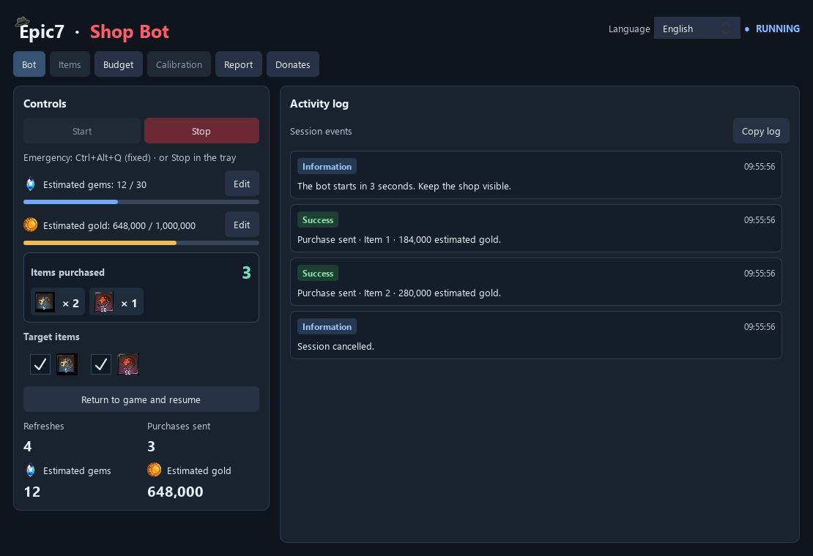
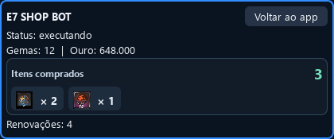
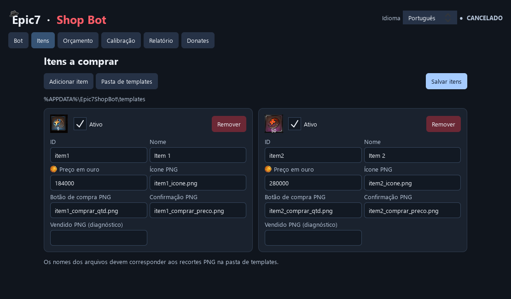
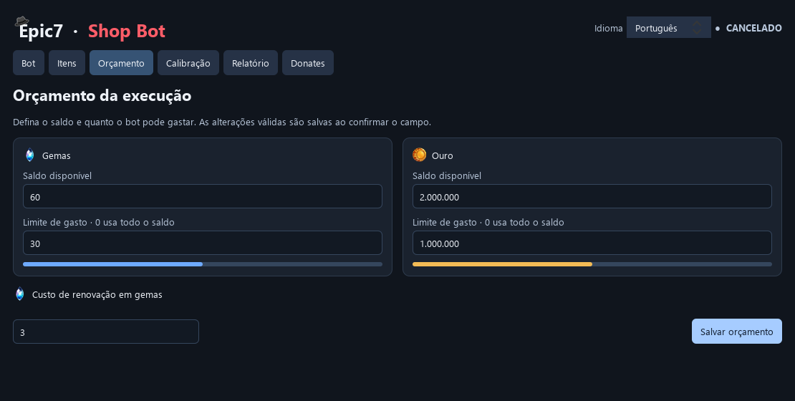
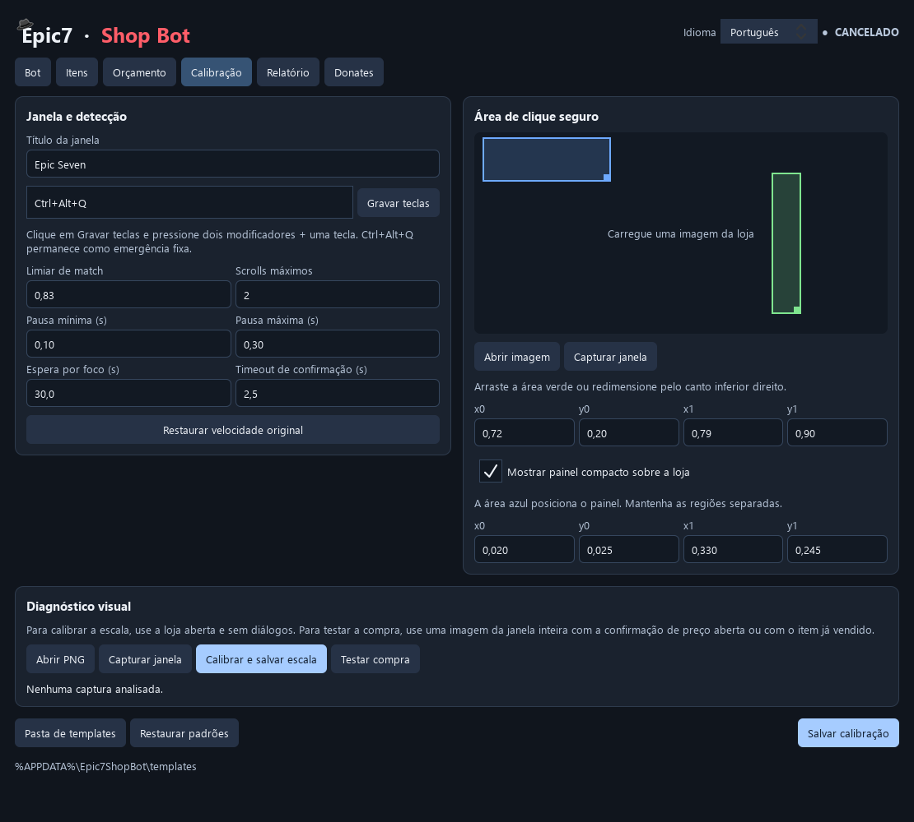
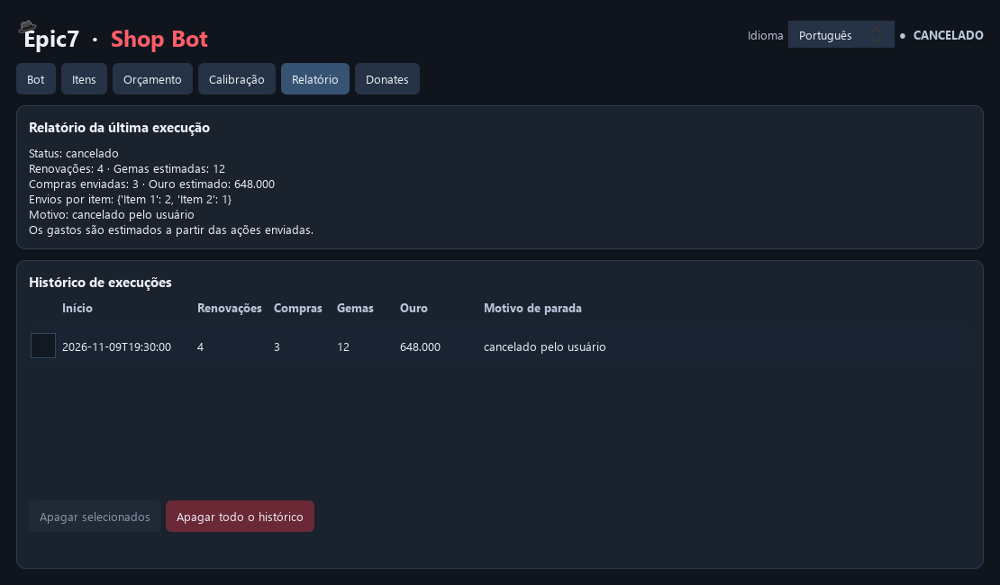
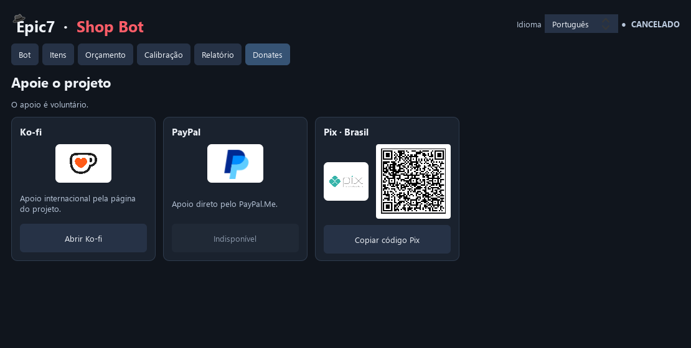

# Epic7 Shop Bot

A Windows desktop application that finds and buys your selected items in the **Epic Seven Secret Shop**, refreshing the shop within the budget you set.

[Português](../README.md) · [Download](https://github.com/Frperoger/Rerol-Secretshop-e7/releases/latest) · [v3 source](https://github.com/Frperoger/Rerol-Secretshop-e7/tree/v3) · [Report an issue](https://github.com/Frperoger/Rerol-Secretshop-e7/issues)



Features include image recognition, separate gold and gem budgets, resolution-specific template scaling, live target selection, item counters with icons, an overlay and session history.

> Screenshots show the QML interface from branch `v3`, with demonstration data. Some features may not yet be included in the latest published executable. The overview above uses English; the detailed screenshots also show the Portuguese labels referenced in this guide.

Use the **Language / Idioma** field at the top of the window to choose **English** or **Português**. The interface updates immediately and remembers your choice for future launches. This changes interface text and number formatting; game language, user-defined item names and recognition PNGs remain as configured.

## Contents

- [Download and first run](#download-and-first-run)
- [Bot tab and overlay](#bot-tab-and-overlay)
- [Items tab](#items-tab)
- [Budget tab](#budget-tab)
- [Calibration tab](#calibration-tab)
- [Reports tab](#reports-tab)
- [Donates tab](#donates-tab)
- [Limitations and troubleshooting](#limitations-and-troubleshooting)
- [Download and run the source](#download-and-run-the-source)
- [Customize and build](#customize-and-build)
- [Local data and backups](#local-data-and-backups)
- [License and restrictions](#license-and-restrictions)

## Download and first run

### Requirements

- **64-bit Windows.** The automation engine uses Windows APIs; macOS and Linux are not supported by the current engine.
- Epic Seven open at the Secret Shop, with its window visible and unobstructed.
- Templates matching your shop's language and appearance. The bundled PNGs are a starting point and may need replacement.
- For source execution, **64-bit Python 3.11**, the version used by the project's build workflow.

### Packaged application

1. Open [Releases](https://github.com/Frperoger/Rerol-Secretshop-e7/releases/latest).
2. Under **Assets**, download `Epic7ShopBot-<version>-win64.zip`.
3. Extract the complete folder.
4. Run `Epic7ShopBot.exe`. Keep the accompanying files and subfolders together.

The packaged app does not require Python. GitHub's **Source code (zip/tar.gz)** downloads contain source files, not the compiled application.

### Set up your first session

1. Open the Secret Shop at the window size and zoom you plan to use.
2. In **Itens**, check the active targets, prices and PNG filenames, then save.
3. In **Orçamento**, enter your available gold/gems and spending limits.
4. In **Calibração**, check the window title, capture the shop and position the green safe-click area. Position the blue area too if you enable the overlay.
5. With the shop open **without dialogs**, click **Calibrar e salvar escala**. Review the diagnostic and save the calibration settings.
6. In **Bot**, click **Iniciar**. There is a three-second delay; leave the game visible and focused.
7. Stop with **Parar**, **Ctrl+Alt+Q**, or **Parar bot agora** in the Windows tray menu.

Use a small budget for your first check. Keep the window's position, size and zoom unchanged during a session.

## Bot tab and overlay

The screenshot at the top shows the main controls.

| Label | Function |
| --- | --- |
| **Iniciar / Parar** | Start or request a stop. Stopping is cooperative; an action already in progress may finish first. |
| **Gemas estimadas / Ouro estimado** | Estimated spending versus the budget. **Editar** opens the Budget tab. |
| **Itens comprados** | Total purchases and per-item counts with icons. Counts reset for each new run. |
| **Itens procurados** | Enable or disable existing targets during a run. Disabling a target preserves its recorded purchases. |
| **Renovações** | Number of completed refresh flows. |
| **Voltar ao jogo e retomar** | Resume after opening the app to inspect or edit settings; return focus to the game. |
| **Registro de atividade** | Relevant purchase, pause, resume and error events. **Copiar registro** copies the visible feed. |

Counters measure **purchases**, not units inside a bundle. Buying one bundle of five units adds **one purchase** to its counter.

At least one target must be enabled to start. Turning off all targets during a run makes the bot wait without buying or refreshing until a target is enabled again.

### Overlay



Enable **Mostrar painel compacto sobre a loja** under Calibration. The overlay fits inside your configured blue area and displays status, costs, item counts and refreshes.

**Voltar ao app** requests a pause at a safe point and opens the main window. Use **Voltar ao jogo e retomar** to continue. The overlay does not take focus from the game. It requires Windows capture-exclusion support; if this fails, the app disables it and reports the problem.

**Closing the main window with X during a run may leave the bot active in the tray.** Use the stop controls to end automation.

## Items tab



Use **Adicionar item** to add a target, **Remover** to remove its configuration and **Salvar itens** to validate and save. Editing item definitions is disabled during a run; existing targets can still be toggled in the Bot tab.

| Field | Meaning |
| --- | --- |
| **Ativo** | Include this target when starting. |
| **ID** | A unique identifier, starting with a lowercase letter and containing lowercase letters, digits, `_` or `-`, up to 32 characters. Example: `item3`. |
| **Nome** | Display name. Distinct names make counters and reports easier to read. |
| **Preço em ouro** | Cost of one purchase, used by the estimated budget. Keep it equal to the game's price. |
| **Ícone PNG** | Item icon crop used for recognition. |
| **Botão de compra PNG** | Purchase-button crop. The current standard uses the single-line `1/1 Comprar` image. |
| **Confirmação PNG** | Price-button crop shown before the final purchase click. |
| **Vendido PNG (diagnóstico)** | Optional sold-state image for offline diagnostics; it is not a required post-purchase check. |

Files must exist in the **active templates directory**. Enter filenames such as `item1_icone.png`, not full paths. **Pasta de templates** selects another directory; save after changing it.

To add or replace templates:

1. Stop the bot and capture the game window at your normal resolution.
2. Make tight PNG crops of the icon, purchase button and price button. Save them in the active templates folder.
3. Fill in the item fields. Multiple targets may reference the same compatible `1/1 Comprar` PNG.
4. Click **Salvar itens** and resolve missing or invalid images.
5. Recalibrate scale and review the diagnostic.

`renovar.png` and `confirmar.png` are also required for shop refreshes. Recognition finds the item icon first, then the purchase button **to its right on the same row**. Row tolerance is internal and has no user-adjustable calibration field.

Single-line purchases are already integrated into the application and its bundled templates. Configure additional targets through the item settings and the PNGs in the active directory.

## Budget tab



| Field | Meaning |
| --- | --- |
| **Saldo disponível** | Balance you enter. The app does not read the game's balance automatically. |
| **Limite de gasto** | Maximum spending for the run. **0 uses the full entered balance**; it does not disable spending. |
| **Custo de renovação em gemas** | Gem cost per refresh, default 3. Editable only while stopped. |

Limits cannot exceed the entered balances. Valid edits are applied when committed; **Salvar orçamento** also saves them. Limits can be adjusted during a session, subject to recorded spending and pending actions.

Example: 60 available gems and a 30-gem limit permit up to ten refreshes at three gems each. Gold and target settings may end the session earlier. Costs and counts are estimates based on sent actions; check actual game balances before restarting after an interruption.

## Calibration tab



The preview is filled when you load an image or capture the game. This screenshot shows the controls before loading a shop capture.

### Window and detection settings

| Label | Function |
| --- | --- |
| **Título da janela** | Game-window title. Use enough text to identify one window. |
| **Gravar teclas** | Record an additional emergency shortcut. The fixed **Ctrl+Alt+Q** shortcut remains available. |
| **Limiar de match** | Recognition threshold, default 0.83. Higher values may miss matches; lower values may accept incorrect ones. |
| **Scrolls máximos** | Maximum scrolls when searching the current shop. |
| **Pausa mínima / máxima** | Delay range between stages. Short delays may run ahead of game animations. |
| **Espera por foco** | Maximum time to wait for the game to regain focus. |
| **Timeout de confirmação** | Wait limit for visual confirmation elements used by the flow. |
| **Restaurar velocidade original** | Restore default pauses and scroll count; save to apply. |

### Green and blue areas

- **Green:** safe-click region. Choose a neutral shop area without purchase buttons or unwanted actions.
- **Blue:** overlay position and size. Keep it away from game controls needed by the bot.

Drag a rectangle to move it or drag its bottom-right corner to resize. `x0`, `y0`, `x1`, `y1` are proportions from 0 to 1 of the game window. The green and blue rectangles must not overlap while the overlay is enabled.

### Save a scale profile

1. Open the shop without dialogs and keep the refresh button visible.
2. Use **Capturar janela** or **Abrir PNG** to load the **entire game window**, without resizing the image externally.
3. Click **Calibrar e salvar escala**.
4. Review refresh recognition and the icons/buttons of any targets visible in that capture.
5. Use **Salvar calibração** to save the other settings.

The diagnostic finds a compatible scale, resizes templates and caches the profile by capture dimensions and PNG fingerprint. It analyzes the image **without moving the mouse or sending purchase clicks**. A validated scale is saved by the diagnostic itself; the Save calibration button saves the other settings.

Recalibrate after changing resolution, zoom, language or templates. A saved profile cannot guarantee recognition on every screen. An item absent from a capture cannot be validated by that capture alone.

### Test a purchase image

**Testar compra** checks recognition in a loaded image; **it does not buy anything**. Load an entire-window capture with the price confirmation visible, or an item already sold, to inspect the configured images and their confidence scores.

**Restaurar padrões** restores factory calibration values after confirmation. Save to persist them. Calibration settings are locked while the bot is active.

## Reports tab



- **Relatório da última execução:** status, refreshes, purchases sent, estimated costs, per-item counts and stop reason.
- **Histórico de execuções:** saved sessions, displaying the latest 100 records.
- **Apagar selecionados:** delete checked records after confirmation.
- **Apagar todo o histórico:** permanently delete all saved records after confirmation, including records older than the 100 visible ones. There is no undo.

History persists between app launches. The visual activity feed belongs to the current session; technical details are written to the local log file.

## Donates tab



Support is optional. Each service logo performs the same action as its card's main button:

- **Ko-fi:** opens the [project's support page](https://ko-fi.com/frperoger).
- **Pix · Brasil:** displays a QR code to scan with your banking app. Click the QR code to enlarge it; the logo and main button copy the Pix payment code. Verify the recipient in your banking app before confirming.
- **PayPal:** remains unavailable until the project configures a payment link.

The thank-you message is shown when a link is opened or the code is copied. The app **does not verify payment receipt**. Donations do not unlock features or grant commercial or redistribution permission.

## Limitations and troubleshooting

The purchase flow finds the icon, finds the matching-row purchase button, waits for the price confirmation and sends the final click. It then records the purchase and continues searching. **There is no post-purchase visual verification or mandatory wait for a dimmed sold image.** An in-memory record prevents buying the same target again in the current shop rotation. Once the search and scrolls finish, the shop is refreshed if budget permits.

Refresh confirmation, focus checks, window geometry checks and safe-click guards remain active.

| Problem | What to check |
| --- | --- |
| Window missing or multiple matches | Open the game and make the configured title specific enough. |
| Paused due to focus | Uncover the game and restore focus. If you opened the app during a session, use **Voltar ao jogo e retomar**. |
| Window moved or resized | The run stops. Position it and restart; recalibrate if dimensions or zoom changed. |
| Refresh or item not recognized | Check language, zoom, crops and active template folder, then run the diagnostic. Administrator mode does not fix incompatible PNGs. |
| Uncertain result | Check the actual shop and balances before restarting. Inspect `sessao.log` for the affected stage. |
| No validated scale | Check refresh visibility, required PNGs and whether the capture covers the entire game window. |
| Overlay disabled | Check region placement and the Windows capture-exclusion warning. Use the app or tray if needed. |
| Replacing bundled PNGs has no effect | Check the active folder. Existing AppData templates are preserved, not automatically replaced by repository images. |
| No active targets | Enable a target in the Bot tab. |

The engine requires a visible, focused game window. It does not automate a minimized/background game, read real balances, or guarantee acceptance of a sent click. Moving the cursor into a screen corner may trigger the input library's FailSafe.

When [reporting an issue](https://github.com/Frperoger/Rerol-Secretshop-e7/issues), include version, steps, resolution/zoom and relevant activity or technical logs. Remove personal information before sharing captures or files.

## Download and run the source

For a ZIP, open [branch v3](https://github.com/Frperoger/Rerol-Secretshop-e7/tree/v3), choose **Code → Download ZIP**, then extract it. A [direct branch ZIP](https://github.com/Frperoger/Rerol-Secretshop-e7/archive/refs/heads/v3.zip) is also available.

Alternatively, install [Git for Windows](https://git-scm.com/downloads/win) and run:

```powershell
git clone --branch v3 https://github.com/Frperoger/Rerol-Secretshop-e7.git
cd Rerol-Secretshop-e7
git switch -c my-customization
```

Install [64-bit Python 3.11](https://www.python.org/downloads/windows/). In the folder containing `main.py`:

```powershell
py -3.11 -m venv .venv
.\.venv\Scripts\python.exe -m pip install --upgrade pip
.\.venv\Scripts\python.exe -m pip install -r requirements.txt
.\.venv\Scripts\python.exe main.py
```

These commands call the virtual environment's Python directly, without PowerShell script activation. If `py -3.11` is missing, check that version's installation. After setup, `iniciar_gui.bat` is another way to launch the app.

## Customize and build

The interface uses **QML**, Qt's declarative language, with JavaScript for interactions. The engine and configuration use **Python**.

| Change | Main files, relative to the repository root |
| --- | --- |
| Colors, title and navigation | [`qml/Main.qml`](../qml/Main.qml) |
| Reusable controls | [`qml/ShopButton.qml`](../qml/ShopButton.qml), [`ShopCard.qml`](../qml/ShopCard.qml), [`LabeledField.qml`](../qml/LabeledField.qml) |
| Bot, purchase counters and activity feed | [`qml/BotPage.qml`](../qml/BotPage.qml), [`PurchaseSummary.qml`](../qml/PurchaseSummary.qml), [`ActivityFeed.qml`](../qml/ActivityFeed.qml) |
| Overlay | [`qml/CompactWindow.qml`](../qml/CompactWindow.qml) |
| Other tabs | `qml/ItemsPage.qml`, `BudgetPage.qml`, `CalibrationPage.qml`, `ReportsPage.qml`, `DonatesPage.qml` |
| QML/Python connection | [`app/ui/quick_window.py`](../app/ui/quick_window.py) |
| Validation, saving and app lifecycle | [`app/ui/main_window.py`](../app/ui/main_window.py) |
| Purchase and refresh sequence | [`app/engine/runner.py`](../app/engine/runner.py) |
| Recognition, scaling and diagnostics | [`app/core/vision.py`](../app/core/vision.py), [`template_scale.py`](../app/core/template_scale.py), [`app/ui/diagnostics.py`](../app/ui/diagnostics.py) |
| Mouse input, capture and window guards | [`app/platform/desktop.py`](../app/platform/desktop.py), [`windows.py`](../app/platform/windows.py) |
| Defaults and persistent settings | [`app/models.py`](../app/models.py), [`app/config.py`](../app/config.py) |
| Languages, translation catalog and interface preference | [`app/ui/language.py`](../app/ui/language.py), [`translations.py`](../app/ui/translations.py) |
| Images | `templates/`, `assets/`, `qml/logos/`, `qml/images/` |

For a visual example, change the `ApplicationWindow` background properties in `qml/Main.qml`:

```qml
color: "#141b26"
palette.window: "#141b26"
```

Save, close the app and rerun `main.py`. These QML components require the Python backend, so test through the application entry point. See the [QML documentation](https://doc.qt.io/qt-6/qtqml-index.html) for language details.

When modifying the app:

- Prefer the settings tabs for prices, targets and budgets. Changing defaults in `app/models.py` does not overwrite an existing AppData configuration.
- Replace your active templates when customizing recognition. Initial copying from the repository only adds missing files and preserves existing ones.
- When customizing the Pix recipient, update both `pixCode` in `qml/DonatesPage.qml` and `qml/images/pix-qr.png` to the same payment destination.
- Connect new QML actions or data through `app/ui/quick_window.py`; the Python main window still owns validations and parts of the lifecycle.
- Preserve focus checks, budget limits, mouse-button release and the per-rotation record of sent purchases when changing the engine.
- Recognition still depends on real game images. Lower delays or thresholds do not guarantee speed or accuracy.

### Tests

```powershell
.\.venv\Scripts\python.exe -m pip install -r requirements-dev.txt
.\.venv\Scripts\python.exe -m pytest -q
```

Tests simulate budgets, recognition, transaction flows, guards and interface connections. They do not replace a small-budget check in the game.

### Windows build

With development dependencies installed:

```powershell
.\.venv\Scripts\python.exe -m PyInstaller --clean --noconfirm build.spec
```

Output: `dist\Epic7ShopBot\Epic7ShopBot.exe`. Keep **the entire `dist\Epic7ShopBot` folder**, including subfolders. The build bundles QML, templates and assets; the executable alone is insufficient.

Editing source does not update an already compiled executable. Run through Python or rebuild. Redistribution requires the license permissions below. To contribute, use a GitHub fork and submit a pull request to the original project under the contribution terms.

## Local data and backups

Open `%APPDATA%\Epic7ShopBot` in File Explorer:

| Path | Contents |
| --- | --- |
| `config.json` | Budgets, targets, calibration and optional custom template path. |
| `interface.json` | Interface language, stored separately from bot settings. |
| `templates/` | Active PNGs when using the default folder. |
| `escalas_templates/` | Scale cache keyed by resolution and image fingerprint. |
| `history.jsonl` | Saved sessions. |
| `logs/sessao.log` | Rotating technical log. |
| `captura_calibracao.png` | Last capture made by the calibration tool. |

Close the bot and copy this folder for a backup. Include any custom template directory separately. When moving to another computer, check paths and recalibrate for its window.

## License and restrictions

Original project material in this revision uses the [Personal and Non-Commercial Use License](../LICENSE.md).

| Use | Permission |
| --- | --- |
| Personal, non-commercial use, study, local modification and compilation | Allowed under the license; retain attribution and license notices. |
| Contributions to the original repository | Allowed under the license's contribution terms. |
| Redistribution of original or modified source/binaries | Requires prior written permission from the author, subject to GitHub platform rights. |
| Sale, paid access, commercial services or other commercial use | Requires prior written permission from the author. |

Publishing source on GitHub does not remove these restrictions. Viewing and fork rights granted by [GitHub's terms](https://docs.github.com/en/site-policy/github-terms/github-terms-of-service#d-user-generated-content) remain applicable. Contact [Frperoger](https://github.com/Frperoger) for additional permission. Donations do not grant extra rights.

Third-party components, game images and trademarks retain their own rights and terms. An authorized redistribution must also respect [Qt/PySide6 licensing](https://doc.qt.io/qtforpython-6/) and other dependency licenses.

This is an independent, unofficial project, unaffiliated with Epic Seven's owners. Use must comply with applicable game terms and policies. The bot's safeguards do not constitute approval from the game service.

## Credits and support

Developed by [Frperoger](https://github.com/Frperoger). This guide's organization was inspired by the [Fribbels Epic 7 Gear Optimizer README](https://github.com/fribbels/Fribbels-Epic-7-Optimizer#readme), using tab-by-tab explanations and screenshots. The projects are independent.

Optional support is available in **Donates** and on the [project's Ko-fi page](https://ko-fi.com/frperoger).
